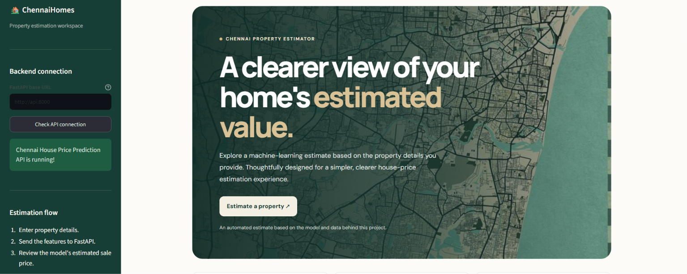
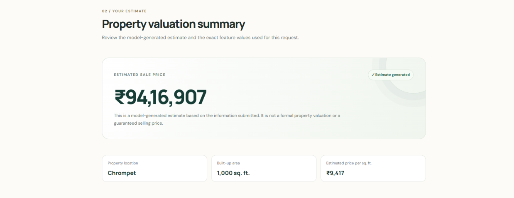
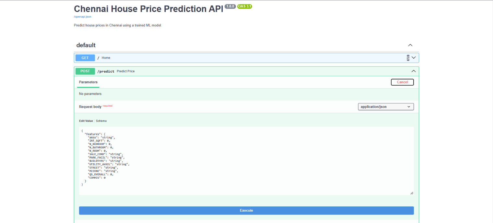

# Chennai House Price Prediction

An end-to-end machine learning application for estimating residential property prices in Chennai, Tamil Nadu, India. This project combines data analysis, feature engineering, model development, model evaluation, and API development into a containerized application.

The application allows users to enter property details and obtain an estimated house price through an interactive interface powered by a machine learning model.

## Overview

Real estate prices depend on several factors, including property characteristics, location, and available amenities. This project explores historical housing data to develop a machine learning solution for predicting residential property prices in Chennai.

The project covers the complete machine learning workflow, from raw data exploration to serving predictions through an API and an interactive frontend.

## Key Features

- **Exploratory Data Analysis:** Investigate distributions, relationships, and patterns in the housing dataset.
- **Data Preprocessing:** Clean data, handle missing values, and prepare features for modeling.
- **Feature Engineering:** Transform property attributes into useful model inputs.
- **Feature Selection:** Identify relevant features to support model development.
- **Model Training and Evaluation:** Establish a baseline and evaluate machine learning models.
- **Hyperparameter Tuning:** Optimize the Random Forest model through systematic parameter search.
- **REST API:** Serve predictions using FastAPI.
- **Interactive Frontend:** Provide a user-facing interface for house price estimation.
- **PDF Reports:** Generate downloadable prediction reports.
- **Docker Support:** Package the application and its dependencies for a reproducible environment.
- **Automated Testing:** Test API endpoints, model behavior, and PDF report functionality.

## Technology Stack

| Category | Technologies |
|---|---|
| Programming Language | Python |
| Data Manipulation | Pandas, NumPy |
| Data Visualization | Matplotlib, Seaborn |
| Machine Learning | Scikit-learn |
| Model Persistence | Joblib |
| Backend | FastAPI |
| API Validation | Pydantic |
| Frontend | Python-based web application |
| Testing | Pytest |
| Containerization | Docker, Docker Compose |
| Development Environment | Jupyter Notebook, VS Code |

## Project Structure

```text
chennai-house-price-prediction/
│
├── app/
│   └── main.py
│
├── data/
│   ├── raw/
│   │   └── chennai_house_price_prediction.csv
│   ├── processed/
│   │   └── chennai_house_price_prediction_cleaned.csv
│   └── README.md
│
├── docs/
│   └── problem definition.md
│
├── frontend/
│   ├── assets/
│   ├── app.py
│   ├── pdf_report.py
│   ├── requirements.txt
│   └── README.md
│
├── models/
│   ├── baseline_model.joblib
│   ├── selected_features.joblib
│   ├── selected_model.joblib
│   └── tuned_random_forest.joblib
│
├── notebooks/
│   ├── 01_dataset_inspection.ipynb
│   ├── 02_initial_eda.ipynb
│   ├── 03_data_cleaning.ipynb
│   ├── 04_oulier_analysis.ipynb
│   ├── 05_handling_missing_values.ipynb
│   ├── 06_feature_engineering.ipynb
│   ├── 07_basemodel_prediction_evaluation.ipynb
│   ├── 08_feature_selection.ipynb
│   └── 09_model_training_tuning.ipynb
│
├── reports/
│   └── baseline_model_results.csv
│
├── tests/
│   ├── test_api.py
│   ├── test_model.py
│   └── test_pdf.py
│
├── .dockerignore
├── .gitignore
├── Dockerfile
├── docker-compose.yml
├── requirements.txt
└── README.md
```

*Note: The structure above reflects the current repository layout. Additional files may exist in the repository.*

## Machine Learning Pipeline

The project follows an end-to-end machine learning pipeline, beginning with raw housing data and ending with a deployed prediction interface that runs locally through Docker.

### Pipeline Overview

```text
Raw Housing Dataset
        |
        v
Dataset Inspection
        |
        v
Data Cleaning
        |
        v
Exploratory Data Analysis
        |
        v
Feature Engineering
        |
        v
Baseline Model
        |
        v
Feature Selection
        |
        v
Model Training and Hyperparameter Tuning
        |
        v
Model Evaluation and Selection
        |
        v
Save Trained Model
        |
        v
FastAPI Prediction Backend
        |
        v
Interactive Frontend
        |
        v
PDF Prediction Report
        |
        v
Docker Containerization
```

### 1. Dataset Inspection

The initial stage examines the Chennai housing dataset to understand its structure, available features, data types, and overall data quality.

This helps identify potential data quality issues before model development begins.

### 2. Data Cleaning

The raw dataset is cleaned to address inconsistencies, missing values, and other data quality problems.

The objective is to prepare a consistent dataset for exploratory analysis and model development.

### 3. Exploratory Data Analysis (EDA)

Exploratory analysis is performed to investigate the distribution of house prices, understand relationships between property characteristics and prices, and identify potential outliers.

Visualizations help reveal patterns that can inform subsequent preprocessing and modeling decisions.

### 4. Feature Engineering

Relevant housing attributes are prepared for machine learning.

This stage transforms the available data into suitable model inputs while ensuring that the same expected feature structure can be provided during prediction.

### 5. Baseline Modeling

A baseline model establishes a reference point against which more advanced models can be evaluated.

This helps determine whether subsequent modeling improvements provide measurable benefits over the initial benchmark.

### 6. Feature Selection

Feature selection identifies the input variables retained for model development.

The selected features must remain consistent between model training and prediction time.

### 7. Model Training and Hyperparameter Tuning

Candidate regression models are trained on the prepared housing data.

Hyperparameter tuning is used to search for suitable model configurations. The project includes a tuned Random Forest model as part of its modeling workflow.

### 8. Model Evaluation and Selection

Candidate models are evaluated using regression metrics, including:

* **MAE:** Mean Absolute Error.
* **MSE:** Mean Squared Error.
* **RMSE:** Root Mean Squared Error.
* **R² Score:** Coefficient of determination.

These metrics provide complementary perspectives on prediction error and model fit.

The final model should be selected based on the actual evaluation results and the project's modeling objectives.

### 9. Model Persistence

The trained model and other required artifacts are saved so that the application can load them without retraining the model whenever a prediction is requested.

This separates model development from application inference.

### 10. FastAPI Backend

FastAPI provides the backend interface for receiving property details and returning price predictions.

The backend validates incoming requests, loads the required model artifacts, performs inference, and returns a structured response.

### 11. Interactive Frontend

The frontend provides a user-facing interface where users can enter property details and request a price estimate.

It communicates with the backend API and presents the prediction in a readable format.

### 12. PDF Report Generation

The application supports generating a downloadable PDF report containing prediction-related information.

This provides a convenient way to retain the output of an individual prediction.

### 13. Docker Containerization

Docker packages the application and its dependencies into containers.

Docker Compose coordinates the backend and frontend services, allowing the complete application to run locally without requiring the user to start each service separately.

### End-to-End Prediction Flow

When a user submits property details through the frontend, the application sends the request to the FastAPI backend. The backend validates the inputs, uses the saved model artifacts to generate a prediction, and returns the estimated price to the frontend.

The frontend displays the result and provides access to the PDF report functionality.

The application can be started locally using Docker Compose, making the project reproducible without requiring a cloud deployment.


## Model Evaluation

Regression models should be evaluated using multiple complementary metrics:

- **R² Score:** Measures the proportion of target variance explained by the model.
- **MAE:** Measures the average absolute prediction error.
- **MSE:** Measures the average squared prediction error.
- **RMSE:** Expresses prediction error on the target's original scale.

The project includes baseline and tuned model artifacts to support model development and comparison.

Actual evaluation results should be reported from the project's saved evaluation outputs. No performance figures are claimed here.

## Getting Started

You can run the application with Docker (recommended) or run the backend and frontend directly with Python.

### Option A: Run with Docker (Recommended)

#### Prerequisites

- [Git](https://git-scm.com/downloads)
- [Docker Desktop](https://www.docker.com/products/docker-desktop/) on Windows/macOS, or Docker Engine with the Docker Compose plugin on Linux

#### 1. Clone the repository

```bash
git clone https://github.com/J-Dharanendiran/chennai-house-price-prediction.git
cd chennai-house-price-prediction
```

#### 2. Build and start the application

Make sure Docker is running, then run this command from the project root:

```bash
docker compose up --build -d
```

Docker Compose builds the API and frontend images from the repository's `Dockerfile` and starts both services. The first build may take several minutes while Docker downloads the base image and installs dependencies.

#### 3. Open the application

- **Streamlit frontend:** http://localhost:8501
- **FastAPI interactive documentation:** http://localhost:8000/docs

The frontend connects to the API through the Docker Compose service network.

#### 4. Check status and view logs

Check whether both services are running:

```bash
docker compose ps
```

View logs from both services:

```bash
docker compose logs
```

To view logs for one service:

```bash
docker compose logs api
docker compose logs frontend
```

#### 5. Stop the application

```bash
docker compose down
```

This stops and removes the Compose containers and network. It does not delete your source files.

### Option B: Run Directly with Python

#### Prerequisites

- Python 3.12 or a compatible Python version
- Git

#### 1. Clone the repository

```bash
git clone https://github.com/J-Dharanendiran/chennai-house-price-prediction.git
cd chennai-house-price-prediction
```

#### 2. Create and activate a virtual environment

**Windows PowerShell**

```powershell
python -m venv .venv
.venv\Scripts\Activate.ps1
```

If PowerShell blocks environment activation, consult the Python documentation for your execution-policy configuration rather than changing security settings unnecessarily.

#### 3. Install dependencies

```bash
python -m pip install --upgrade pip
pip install -r requirements.txt
pip install -r frontend/requirements.txt
```

#### 4. Start the backend API

From the project root, run:

```bash
uvicorn app.main:app --reload
```

The API is available at `http://127.0.0.1:8000`, and its interactive documentation is at `http://127.0.0.1:8000/docs`.

#### 5. Start the frontend

Open a second terminal in the project root, activate the same virtual environment, and run:

```bash
streamlit run frontend/app.py
```

The frontend is typically available at `http://localhost:8501`.

Ensure the frontend's API base URL is configured for your local backend when running outside Docker. The Docker Compose configuration uses `http://api:8000` for communication between containers; that service hostname is intended for the Compose network.
## Running Tests

Run the test suite from the project root:

```bash
pytest
```

The tests cover API behavior, model functionality, and PDF report generation.

## Model Artifacts

The `models/` directory contains serialized model-related artifacts used during model development and application execution.

| Artifact | Purpose |
|---|---|
| `baseline_model.joblib` | Baseline model artifact |
| `selected_features.joblib` | Saved feature-selection information |
| `selected_model.joblib` | Selected model artifact |
| `tuned_random_forest.joblib` | Tuned Random Forest model artifact |

The application must load the correct model and supply features in the expected format. The saved artifacts should remain compatible with the corresponding preprocessing logic and library versions.

Only load Joblib files from trusted sources because serialized Python objects can execute code when deserialized.

## Application Screenshots

### 1. House Price Estimator



### 2. Prediction Results and PDF Report



### 3. FastAPI Swagger UI



## Dataset

The project uses a Chennai house price prediction dataset containing residential property information and associated prices.

The dataset is organized into raw and processed directories:

- `data/raw/`: Source dataset.
- `data/processed/`: Cleaned dataset prepared during the data processing workflow.

Refer to `data/README.md` for additional dataset information.

Before redistributing the dataset, verify its source, license, and applicable usage restrictions.

## Limitations

- Predictions are estimates based on patterns learned from historical data.
- Actual property prices may vary with market conditions, property condition, location, and other factors not represented in the dataset.
- Model performance depends on the quality, coverage, and representativeness of the available data.
- Predictions should not be treated as professional property valuations or guarantees of market price.
- The application is intended for learning, demonstration, and experimentation rather than as a substitute for professional real estate advice.

## Future Improvements

Potential extensions include:

- More extensive model comparison and validation.
- Improved handling of location-specific property characteristics.
- Model monitoring and prediction logging.
- Input validation and API security improvements.
- Automated testing in a continuous integration pipeline.
- Model versioning and reproducible training workflows.
- Deployment to a hosting platform when required.

## Learning Objectives

This project demonstrates practical experience with:

- End-to-end machine learning development.
- Data preprocessing and exploratory analysis.
- Regression modeling and evaluation.
- Feature selection and hyperparameter tuning.
- REST API development with FastAPI.
- Frontend and backend integration.
- Model serialization and loading.
- Automated testing.
- Docker-based application packaging.
- Git and GitHub version control.

## Author

**J. Dharanendiran**

B.Tech Artificial Intelligence and Data Science

GitHub: [J-Dharanendiran](https://github.com/J-Dharanendiran)

## License

No license has been specified for this repository. Unless a license is added, others generally do not receive permission to reuse, modify, or redistribute the project's copyrighted code beyond applicable legal exceptions.

If you intend to make the project open source, consider adding an appropriate license after confirming that you have the rights to license all included materials.
